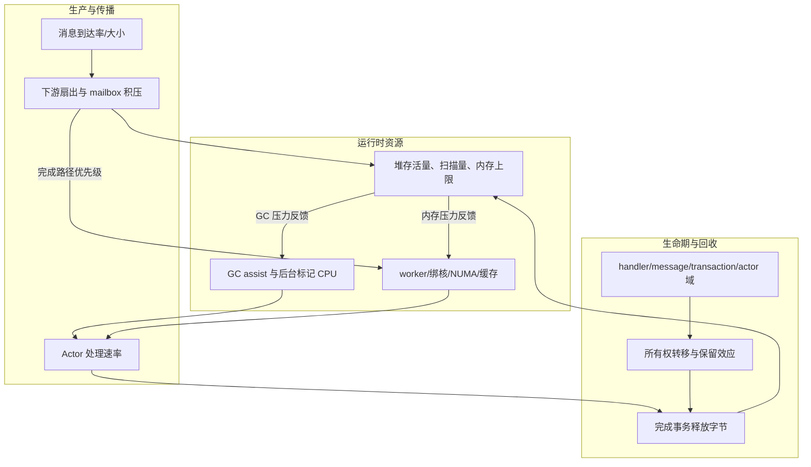

# Actor 系统运行时优化文献调研

> 调研日期：2026-09-15  
> 种子论文：Emilio Francesquini, Alfredo Goldman, Jean-François Méhaut. *Improving the Performance of Actor Model Runtime Environments on Multicore and Manycore Platforms*. AGERE! 2013. DOI: [10.1145/2541329.2541342](https://doi.org/10.1145/2541329.2541342)  
> 目的：从种子论文的参考文献与后续引用出发，梳理 Actor 系统中与调度、局部性、消息、内存管理和运行时自适应有关的优化，并判断哪些方向适合 OscarGo/Go 去活场景。

## 1. 结论摘要

这批文献给出的共同结论是：Actor 运行时优化不能只看 CPU 是否繁忙，也不能只看堆是否接近上限。真正决定效果的是 **Actor 状态、消息负载、通信拓扑、执行粒度、内存位置和对象所有权** 的组合。

对当前项目最有价值的方向按优先级排序如下：

1. **把 mailbox 纳入生命期分析。** 分析消息从发送端对象、消息封装、mailbox 节点到接收端处理结束的完整引用链，明确哪些引用可在入队、出队或处理完成后提前清除。
2. **补充消息所有权/发送效应分析。** 现有跨函数生命期分析需要新增 `may-send`、`ownership-transfer`、`may-retain` 等摘要，以便识别“发送后源端不再使用”的对象。接口调用不能解析时，使用保守摘要、构造点类型集合与运行时保护共同补足精度。
3. **让 GC 感知事务完成和可回收收益。** 将“完成事务数、最近释放字节、mailbox 中待处理字节、在途事务存活字节、GC 扫描/回收比”作为运行时信号，减少在大量对象仍被事务持有时的低收益 GC，并在一批事务结束后及时回收。
4. **使 Cohort 调度策略感知消息和内存。** 绑核提高局部性，但也可能使快路径继续制造在途状态、使慢路径或汇聚 Actor 得不到足够 CPU。调度时应同时考虑通信亲和、Actor 状态大小、消息大小、mailbox 积压字节、事务释放价值以及 NUMA/缓存争用。
5. **把 mailbox quantum 作为 CPU/内存协同旋钮。** 单次调度处理更多消息能降低调度开销，但会损害公平性，并可能造成下游突发积压。它适合动态调节，不能固定为“越大越好”。

这些方向都可以放在编译器、Go 运行时或 OscarGo 运行时层实现，不要求通过限制业务入口速率来换取内存安全。

## 2. 种子论文的核心思想与局限

种子论文把 Actor 运行时放到分层内存平台上考察，提出三类关键信息：

- **Actor 特征**：长生命周期 hub Actor、短生命周期 Actor、Actor 状态大小、消息通信关系。
- **平台特征**：处理器层次、NUMA 距离、本地内存和显式数据迁移。
- **运行时决策**：初始放置、分层 work stealing、迁移后返回 home node、从近到远窃取任务。

其前序实证论文 *A NUMA-Aware Runtime Environment for the Actor Model* 报告了部分 BenchErl 工作负载最高约 2.5 倍的提升；同时也存在退化。后续研究指出，原方案依赖“少数 hub 创建并频繁通信于大量子 Actor”的假设，面对对称多对多、多个 hub 或没有 hub 的通信图时并不稳健。

因此，种子论文对本项目最大的启发不是“给 Actor 固定 home node”，而是：**运行时必须先识别工作负载的通信和内存特征，再选择放置、迁移和回收策略。**

## 3. 引用链与主题演化

OpenAlex 将种子论文标记为引用 22 篇作品、被 7 篇作品直接引用（查询日期 2026-09-15）。直接引用它的工作主要沿三条路线发展：多核 Actor 调度、Actor 内部并行模式、流式处理；另有论文将其用于多核平台或 Agent/Actor 运行时背景。

```mermaid
flowchart LR
    A[2004 Erlang<br/>消息分析引导分配与增量 GC] --> D[2011 SOTER<br/>静态推断所有权转移]
    B[2013 NUMA-aware Actor runtime] --> C[2013 种子论文<br/>Actor 特征 × 内存层次]
    B --> E[2018 Locality-aware work stealing]
    C --> F[2017 CAF locality-guided scheduling]
    C --> G[2020 Macro Actor + Parallel Patterns]
    C --> H[2020 Actor stream processing]
    I[2015 Actor ownership GC] --> J[2017 ORCA<br/>类型系统 × Actor-local GC]
    K[2014 CAF<br/>mailbox、work stealing、quantum] --> E
    K --> L[2018 CAF 事件通知<br/>时延 × CPU]
    M[2018 ElasticActor<br/>动态调度粒度] --> N[运行时自适应]
    O[2025 Iso<br/>请求私有 GC] --> P[事务阶段/完成感知 GC]
    D --> Q[当前项目<br/>消息所有权与生命期摘要]
    E --> R[当前项目<br/>Cohort 的 CPU/内存协同调度]
    J --> Q
    P --> R
```



## 4. 优化手段综述

### 4.1 Actor 放置、NUMA 局部性与 work stealing

**Francesquini et al. 2013** 的两篇前序论文分别从 NUMA-aware 运行时和层次化调度展开种子论文的主要机制：分散 hub Actor，将其子 Actor 优先放在同一 NUMA 节点，空闲 worker 先在近处窃取，再逐级扩大范围。

**Barghi and Karsten 2018** 进一步把影响局部性的因素拆成三类：

- Actor 本地状态及其访问强度；
- 消息大小、分配位置和接收端访问强度；
- 一对一、多对一、多对多、分组通信等拓扑。

论文设计了两种 locality-aware scheduler：一种把被消息唤醒的 Actor 放在发送端附近，另一种尽量恢复到 Actor 原来的 worker。实验表明，局部性策略在中心 Actor、分组通信等负载中最高可获得约 5 倍或 10 倍提升，但在 publish/subscribe、对称多对多和锁竞争强的场景中会退化。短于约 20 μs 的细粒度任务还会使大量 thief 对同一 deque 的竞争急剧放大。

**Wölke et al. 2017** 在 CAF 中区分：

- **通信局部性**：相互通信的 Actor 是否靠近；
- **执行局部性**：Actor 是否回到缓存仍然热的 worker。

其 64 核 NUMA 实验在数据密集负载中最高提升约 25%。这再次说明局部性需要根据负载选择，不能以固定绑核替代运行时决策。

**对当前项目的含义**：Cohort 绑核应增加内存侧反馈。一个 Actor 是否应保持亲和，至少要结合 `actor_state_bytes`、`message_bytes`、`mailbox_bytes`、`remote_access_estimate`、`run_queue_delay` 和 `transaction_release_value`。当某个节点的已存活事务内存持续上涨时，应优先让能推进事务结束的 Actor 获得执行机会，而不是简单降低新事务吞吐。

### 4.2 mailbox、调度批量和唤醒机制

**CAF 2014** 展示了一个典型高性能 Actor 运行时的组合：每 worker 一个 deque、work stealing、O(1) lock-free mailbox、copy-on-write 消息和可配置的 `max_msgs`。`max_msgs` 表示 Actor 一次获得 CPU 后最多连续处理多少条消息。

这里存在直接影响当前场景的三角关系：

- 批量大：调度次数少、吞吐高；
- 批量小：Actor 间更公平、单条消息等待时间低；
- 中间 Actor 批量过大：可能一次向下游产生大量工作，造成 mailbox 突发和在途内存上升。

**Torquati et al. 2018** 研究 CAF 在低消息率下的高延迟问题。持续激进轮询虽能降低唤醒延迟，却会占满 CPU；按需轻量事件通知在不损害高压吞吐的情况下，把低/中消息率下的时延降低最多两个数量级。对本项目而言，这说明“为 GC 留出 CPU”和“降低消息时延”并非必然冲突，worker 睡眠/唤醒机制本身就是可以优化的资源。

**Buhr et al. 2023** 的 Extended Actors 进一步组合了显式 Actor/消息生命期、Actor 与 coroutine 的协作、ready queue 与 mailbox 解耦、队列分片，以及一次取得 mailbox 中一批消息以摊薄锁开销。它提醒我们：mailbox 的数据结构、调度队列的竞争和批处理策略需要一起分析。

**对当前项目的含义**：OscarGo 的 dispatcher `throughput` 应从固定 CPU 参数升级为运行时变量。建议先研究“每次调度处理 N 条消息”对以下指标的曲线，而不是立即实现复杂控制器：

- 事务完成率与 P99 消息延迟；
- mailbox 条目数和字节数；
- 每个业务阶段的存活字节；
- 每完成一个事务产生的分配字节、扫描字节和可回收字节；
- 下游 Actor 的突发度和 ready queue 等待时间。

### 4.3 消息复制、引用传递与所有权转移

“发送消息”在不同 Actor 系统中的含义差异很大。协作拓扑是 MPSC、SPMC 还是 MPMC，并不能直接回答消息是否复制；答案取决于语言语义和 mailbox 实现。

**Sagonas and Wilhelmsson 2004** 面向 Erlang 的复制消息语义，提出：

- 每进程私有堆，使本地 GC 通常不需要跨线程同步；
- 静态消息分析预测哪些对象可能成为消息，并直接在共享区域分配；
- 为该堆布局设计增量、低暂停 GC。

该方法的关键不是“统一使用共享堆”，而是让编译器的消息流分析指导分配位置，避免对象先进入发送端私有堆、发送时再复制一次。

**Negara, Karmani and Agha 2011** 的 SOTER 保留 pass-by-value 语义，同时静态推断消息内容能否安全转移所有权。若发送后源端不再读取或修改对象，就用指针传递代替深拷贝；无法证明时仍走复制路径。论文报告部分程序最高可达一个数量级加速，但它不识别安全的只读共享，且依赖较精确的静态分析。

**CAF** 使用 copy-on-write 降低复制次数。这适合多个接收方共享只读消息的情况，但写时复制、引用计数和消息实际保留时间仍可能增加内存压力。

**对当前项目的含义**：Go 接口值、slice、map、pointer 和含指针 struct 的普通赋值通常只是复制描述符或指针，并不会深拷贝底层对象。是否能“回收原对象”必须沿 mailbox 的实际引用链判断。建议把消息发送建模为以下几类效应：

| 效应 | 编译器可做的事 | 运行时语义 |
|---|---|---|
| `borrow-readonly` | 证明处理期间只读 | 共享引用，直到所有借用结束 |
| `move` | 证明发送后源端不可再用 | 所有权转给接收端/事务域 |
| `copy` | 无法证明隔离或接收端可能修改 | 复制 payload |
| `retain` | 接收端可能保存到 Actor 状态 | 延长到 Actor/显式释放点 |
| `transient` | 只在单次 handler 内使用 | handler 返回即可清理消息引用 |

对于当前接口调用精度不足的问题，可以分三层补偿：

1. 由 Props/Actor 构造点建立 receiver 的可能具体类型集合；
2. 为接口方法生成保守的发送/保留效应摘要，并在闭世界可证明时合并具体实现摘要；
3. 对 PGO 中高度单态的调用插入类型保护，命中时走显式回收/所有权转移快路径，失配时回退到标准 GC 语义。

### 4.4 Actor-local GC、类型系统与事务私有 GC

**Clebsch et al. 2015/2017 的 Pony-ORCA** 将 Actor 隔离性质用于 GC：对象由创建它的 Actor 所有，跨 Actor 引用通过消息协议和延迟引用计数维护；Actor 可以独立、并发地收集自己的对象。Pony 的 reference capability 类型系统证明无数据竞争和跨 Actor 引用安全，使 ORCA 不需要全局 stop-the-world，也不需要常规读/写屏障。

这个方向与 Go 的差距很大：Go 允许普通共享指针、接口动态分派和任意 goroutine 间共享，不能直接照搬 ORCA。可迁移的部分是 **用编译器证明生成局部回收域**：仅当一组对象被证明属于某个事务/Actor 且没有逃出时，才使用 Actor-local 或 transaction-local 的批量回收路径。

**Qiu and Blackburn 2025 的 Iso** 不是 Actor 论文，但与目标场景高度相关。它把请求私有对象隔离到请求域，并在请求结束时整体回收，减少全堆 GC 工作。对当前方案最直接的抽象是：

```text
对象生命周期域 = {handler, message, transaction, actor, global}
```

现有生命期分析已经能跨函数和上下文，下一步可以把“事务域”作为比函数更稳定的回收单位。接口导致证明失败时，对象回退到标准 Go 堆，不影响正确性。

### 4.5 动态执行粒度与结构化并行

**ElasticActor 2018/2019** 将多个 Actor 分配到共享 mailbox 的 actor station，并以 station 数量作为最小调度粒度。系统通过平均延迟模型选择 station 数，在其实验中相对 CAF/Orleans 获得最高约 1.3 倍吞吐，并将平均时延降到约 0.75 倍。其代价是改变调度和 mailbox 组织，需要重新确认 Actor 隔离、公平性和热点竞争。

**Rinaldi et al. 2020** 将 pipeline、farm、map、stencil 等并行模式封装成对外仍表现为 Actor 的“macro Actor”，内部使用共享内存、引用传递、原生线程和 CPU affinity。它适合计算结构稳定、可识别为并行模式的 Actor 子图。对于当前去活流程，它可作为后续方向，但优先级低于消息生命期和 GC 协同，因为它对业务/框架结构的改动更大。

### 4.6 Actor 实体回收与对象回收的区别

**Plyukhin, Agha and Montesi 2025 的 CRGC** 以及更早的 Actor GC 研究解决的是：分布式 Actor 之间可能形成引用环时，如何判断一个 Actor 永远不会再收到可达消息，从而回收 Actor 实体。CRGC 还考虑节点故障和恢复。

这类工作对“短生命周期 Actor 大量创建”的系统有价值，但当前场景的主要问题是长生命周期 CS/DS/DO Actor 持有大量事务对象。因此，它们可以帮助定义 Actor 终止和 in-flight message 的语义，却不能替代 Go 堆对象的生命期分析。

## 5. 面向当前项目的统一模型

建议把 CPU/内存协同模型分为三个相互反馈的面：



### 5.1 建模指标

| 维度 | 建议指标 | 作用 |
|---|---|---|
| 消息 | 到达/消费速率、条目数、payload 字节、消息年龄 | 区分 CPU 拥塞与内存拥塞 |
| 事务 | 各阶段事务数、完成率、阶段停留时间、事务存活字节 | 估计未来释放量和 OOM 风险 |
| Actor | handler CPU、单次 quantum、状态字节、阻塞/就绪时间 | 识别推进事务的瓶颈 Actor |
| 调度 | worker 队列、窃取、迁移、Cohort/CPU、NUMA 节点 | 判断亲和收益与争用 |
| GC | GC CPU、assist、扫描字节、回收字节、扫描/回收比 | 识别“低收益 GC” |
| 内存 | heap live、heap goal、RSS、GOMEMLIMIT 余量 | OOM 预警与控制 |

### 5.2 建议的运行时控制目标

优化目标不应只写成“降低堆峰值”，建议使用带约束的多目标：

```text
最大化：事务完成率
最小化：P99 消息时延、GC CPU、堆/RSS 峰值
约束：不降低基线去活吞吐，不显著增加关键消息时延，不发生 OOM
```

在该目标下，策略优先级可以是：

1. 清理已经无用的引用和回收已完成事务域；
2. 给能够结束高内存事务的 Actor 足够 CPU；
3. 调整 GC 触发时点和并发 GC CPU 份额；
4. 调整 mailbox quantum、Actor 亲和与 work stealing；
5. 只有在上述手段不足时，才讨论入口背压。

## 6. 建议优先验证的四个研究假设

### H1：mailbox/上下文残留引用是事务结束后内存不能立即下降的重要来源

做法：在出队、handler 返回、事务阶段结束处记录对象/消息引用清理，并用 heap profile 对比 retaining path。检查 ring buffer/队列槽位是否在 dequeue 后置零，envelope、sender、context、future/response 是否继续持有 payload。

判定：若显式清理后 heap live 或事务完成后的 retained bytes 显著下降，则优先实现 mailbox 生命周期协议。

### H2：当前 Cohort 加速生产端多于完成端，形成内存正反馈

做法：按 Actor 类型和事务阶段采集 `produced_bytes/s`、`released_bytes/s`、run queue wait、CPU time 和 mailbox bytes；比较开/关 Cohort。

判定：若某些 Actor 的处理率上升伴随下游积压和完成率下降，应把“释放价值”和积压字节加入调度，而不是取消 Cohort。

### H3：在事务高存活阶段，部分 GC 周期的扫描/回收比很差

做法：每轮 GC 关联事务阶段直方图、完成事务数、扫描字节、释放字节与 assist CPU。

判定：若高并发阶段存在连续低回收收益 GC，而事务完成窗口后的收益明显提高，则实现事务完成感知的 GC pacing/触发补充信号。

### H4：接口调用是生命期分析覆盖率的主要瓶颈，且在业务运行中多数调用点接近单态

做法：编译期记录候选实现数，运行期采样真实 concrete type；统计接口调用涉及的分配字节及其最终生命期域。

判定：若大部分热点接口调用点实际只有 1–2 个 concrete type，优先实现“类型集合 + PGO guard + 保守回退”。

## 7. 论文清单与项目相关性

| 年份 | 论文 | 标识 | 主要贡献 | 当前项目相关性 | 本地 PDF |
|---:|---|---|---|---|---|
| 2004 | Sagonas & Wilhelmsson, Message Analysis-Guided Allocation and Low-Pause Incremental GC | [DOI](https://doi.org/10.1145/1029873.1029875) | 消息分析指导共享区分配；进程私有堆；增量 GC | 高：消息效应、分配位置、局部回收 | 已保存 |
| 2011 | Negara et al., Inferring Ownership Transfer for Efficient Message Passing | [DOI](https://doi.org/10.1145/1941553.1941566) | 静态推断 move，避免深拷贝 | 高：扩展生命期分析 | 已保存 |
| 2013 | Francesquini et al., A NUMA-Aware Runtime Environment for the Actor Model | [DOI](https://doi.org/10.1109/ICPP.2013.34) | hub/子 Actor 放置与 NUMA-aware work stealing | 高：Cohort 的对照与边界 | 未下载；元数据已核对 |
| 2013 | Francesquini et al., Actor Scheduling for Multicore Hierarchical Memory Platforms | [DOI](https://doi.org/10.1145/2505305.2505313) | 层次内存平台的 Actor 调度 | 高：种子论文的实证基础 | 未下载；元数据已核对 |
| 2013 | Francesquini et al., Improving the Performance… | [DOI](https://doi.org/10.1145/2541329.2541342) | Actor 特征与多级内存协同 | 高：种子论文 | 用户原始文件 |
| 2014 | Charousset et al., CAF | [DOI](https://doi.org/10.1145/2687357.2687363) | lock-free mailbox、COW、work stealing、`max_msgs` | 高：mailbox 与 quantum | 已保存 |
| 2014 | Imam & Sarkar, Savina | [DOI](https://doi.org/10.1145/2687357.2687368) | Actor 通信拓扑和运行时基准集 | 高：实验设计 | 已保存 |
| 2015 | Clebsch et al., Ownership and Reference Counting based GC in the Actor World | [PDF](https://www.ponylang.io/media/papers/OGC.pdf) | Actor 所有权和延迟引用计数 | 中高：局部回收协议 | 已保存 |
| 2017 | Clebsch et al., ORCA | [DOI](https://doi.org/10.1145/3133896) | 类型系统与 Actor-local 并发 GC 协同 | 高但实施成本大 | 已保存 |
| 2017 | Wölke et al., Locality-Guided Scheduling in CAF | [DOI](https://doi.org/10.1145/3141834.3141836) | 通信/执行局部性调度 | 高：Cohort 策略 | 已保存 |
| 2018 | Barghi & Karsten, Work-Stealing, Locality-Aware Actor Scheduling | [DOI](https://doi.org/10.1109/IPDPS.2018.00058) | 按状态、消息和拓扑选择 locality 策略 | 高：避免固定亲和退化 | 已保存 |
| 2018 | Torquati et al., Reducing Message Latency and CPU Utilization in CAF | [DOI](https://doi.org/10.1109/PDP2018.2018.00028) | 按需唤醒降低空转和低负载延迟 | 中高：worker/GC CPU 协同 | 已保存 |
| 2019 | Zhao et al., ElasticActor | [DOI](https://doi.org/10.1007/s10766-018-0613-7) | 自动调整 Actor 调度粒度 | 中：动态 quantum/聚合 | 已保存（作者稿） |
| 2020 | Rinaldi et al., Improving Performance… with Parallel Patterns | [DOI](https://doi.org/10.1007/s10766-020-00663-1) | macro Actor 内部使用共享内存并行模式 | 中：结构化 Actor 子图 | 下载失败；公开作者稿链接已记录 |
| 2020 | Rinaldi et al., High-throughput Stream Processing with Actors | [DOI](https://doi.org/10.1145/3427760.3428338) | Actor 与高吞吐流模式结合 | 中：消息批处理 | 下载失败；公开作者稿链接已记录 |
| 2023 | Buhr et al., High-performance Extended Actors | [DOI](https://doi.org/10.1002/spe.3262) | 显式生命期、队列分片、批量 mailbox | 高：运行时数据结构 | 未下载；出版页已核对 |
| 2025 | Qiu & Blackburn, Iso | [DOI](https://doi.org/10.1145/3729285) | 请求私有堆和请求结束回收 | 高：事务域回收与 GC 时点 | 已保存 |
| 2025 | Plyukhin et al., CRGC | [DOI](https://doi.org/10.1145/3729288) | 可容错的分布式 Actor 实体 GC | 低到中：定义 Actor 终止边界 | 已保存 |

### 引用计数说明

- 种子论文：OpenAlex 引用数 7，查询于 2026-09-15。
- 其 7 篇直接引用作品在同日 OpenAlex 返回的引用数依次为：CAP Bench 16、Extending Parallel Programming Patterns with Adaptability Features 3、Improving the Performance of Actors on Multi-Cores with Parallel Patterns 4、Jason reasoning-cycle architecture 4、Francesquini 博士论文 1、Francesquini 2014 学位论文 0、High-throughput Stream Processing with Actors 0。
- 其他论文未在本轮统一统计引用数。OpenAlex 在扩展查询时触发限流，Semantic Scholar DOI 查询出现 TLS 失败；本报告不把缺失值记作 0，也不混用不同平台的引用数。

## 8. 当前证据的边界

1. 这是一份由种子论文扩展的目标性文献调研，不是完整的系统综述。
2. 不同论文使用 Erlang、CAF、Pony、Java/Scala 或自研运行时，内存语义不能直接套用到 Go。
3. 文献中的峰值加速来自特定微基准、机器和通信图；本项目必须用真实去活流量重放验证。
4. Actor 实体垃圾回收、Actor-local 对象回收和 Go 全堆 GC 是三个不同问题。
5. 本轮无法调用 literature-review 技能要求的 scientific-schematics 工具，因此用 Mermaid 保存了可编辑的主题图和统一模型图。

## 9. 推荐下一步

下一步应先做 OscarGo mailbox 的实现审计，而不是立即设计新的 GC 算法。需要回答：

- `Send/Tell/Request` 到入队期间复制了哪些值，保留了哪些引用；
- 队列节点/数组槽在出队后何时置零和复用；
- `Ctxt`、future、response、middleware、dead-letter 是否延长 payload 生命周期；
- dispatcher 的 `throughput`、入队唤醒和任务重入如何实现；
- 一个去活事务跨 CS/DS/DO 消息时，哪个对象能作为稳定的 transaction-domain 根。

获得这些事实后，再把本报告的 H1–H4 变成可执行的实现方案和实验计划。

