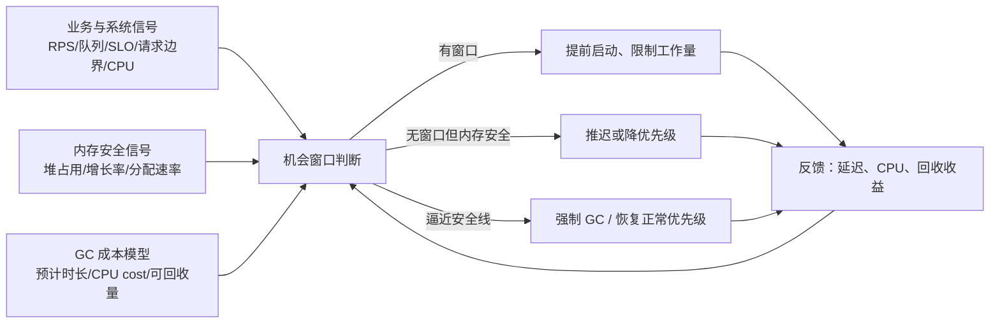

# 业务感知与机会式垃圾回收：文献调研

> 调研日期：2026-09-18  
> 主题：让 GC 感知业务负载、空闲窗口、请求边界或系统资源，不再只由堆增长被动触发。  
> 引用信息见 [`references.bib`](references.bib)，论文原文见 [`pdfs/`](pdfs/)。

## 1. 结论摘要

现有工作并没有形成单一的“业务感知 GC”方案，而是沿四个互补层次推进：

1. **改变触发时机**：MicroPhase 用分配阶段边界，V8 Idle-Time GC 用渲染空闲 deadline，iGC、LEGO、OppZGC 用 CPU 空闲度与堆压力决定是否提前回收。
2. **改变 GC 的工作粒度**：LEGO 将 Go 的全堆回收拆成 P 级增量工作；V8 将 major GC 拆为增量 marking step；Iso 将堆拆成请求/线程私有局部堆。
3. **改变 GC 与业务线程的资源关系**：iGC 利用 SMT 亲和性和优先级；Monk 将 GC 放到 `SCHED_IDLE`，只在关键区或饥饿风险下恢复正常优先级；Platinum 隔离 mutator 和 GC；异构核工作把 GC 放到能效核；DGC 进一步把 marking 外置并池化。
4. **保留安全回退路径**：所有实用方案都没有完全抛弃堆阈值。CPU/业务信号只负责“择机提前做”，接近内存上限、分配停顿或 GC 饥饿时仍必须强制回收。

最值得用于 Go 云服务的设计不是单一阈值，而是一个闭环：

其中，**业务提示应是 soft hint，而不是正确性依赖**；GC 必须能在提示缺失、预测错误或持续高负载时独立保证内存安全。

## 2. 调研方法与范围

- 种子论文为用户指定的四篇工作；沿其参考文献、后续引用及作者研究线扩展。
- 重点筛选同时满足至少一项的工作：使用业务阶段/请求边界；利用空闲 CPU 或 deadline；按 CPU 预算控制 GC；隔离或池化 GC 资源。
- 元数据以 ACM、USENIX、期刊官网、arXiv 和作者公开版本交叉核对。
- 本报告详细分析四篇种子论文，并选取七篇延伸工作形成时间线。传统低停顿 GC（ZGC、Shenandoah、LXR 等）仅作为基线，不单独展开，因为它们主要改变并发算法，而非让 GC 感知业务时机。
- 注意：`Opportunistic ZGC` 截至调研日仍是 arXiv 预印本；其结果尚未经过正式会议/期刊同行评审。

## 3. 核心论文

### 3.1 Improving Concurrent GC for Latency Critical Services in Multi-tenant Systems（iGC）

**基础信息**

- 作者：Junxian Zhao, Aidi Pi, Xiaobo Zhou, Sang-Yoon Chang, Chengzhong Xu
- 发表：ACM/IFIP Middleware 2022，pp. 43–55
- DOI：10.1145/3528535.3531515
- 本地 PDF：[`2022-Zhao-Improving-Concurrent-GC.pdf`](pdfs/2022-Zhao-Improving-Concurrent-GC.pdf)
- BibTeX：`zhao2022igc`

**背景与问题**

低延迟服务与批处理任务共置时，并发 GC 虽减少 STW，却会与 mutator、批处理任务同时竞争 CPU、cache 和执行流水线。ZGC 只依据 JVM 内部的堆状态触发，既不知道操作系统是否有空闲 CPU，也不知道共置任务当前是否正在抢占资源。因此，GC 很可能恰好在请求高峰期启动；反过来，系统空闲时又可能错失提前回收的机会。

仅靠 OS 调度也不够：OS 看不到 JVM 内 GC 线程、业务线程及共享堆之间的语义关系；仅调 GC 线程优先级会牺牲回收进度；仅限制 batch CPU 则浪费共置带来的吞吐收益。

**核心 insight 与设计**

iGC 的核心判断是：并发 GC 的痛点不只在 pause，而在 **GC 被触发的时机和线程放置与系统实际资源状态脱节**。因此它在 JVM 和 OS 之间加入中间层，形成三个组件：

- **Monitor**：经 JMX 和 Linux 接口采集堆占用、CPU 使用率、线程状态。
- **短期控制器**：使用双堆阈值和 CPU 阈值。堆低于阈值 A 时不主动 GC；处于 A 与 B 之间时，仅在 GC 所在 CPU 足够空闲时提前 GC；超过 B 时无条件触发，以避免 allocation stall。触发通过 JVM/JMX 的外部 GC 接口完成。
- **长期控制器**：根据历史效果调整堆阈值、CPU 阈值、检查间隔和 GC 线程数。
- **资源编排**：识别 mutator、GC 和 batch 线程，将同一 JVM 的 GC 与业务线程放到同一物理核的 SMT sibling 上以利用共享 cache，同时通过亲和性、优先级和 cgroup 限制 batch 干扰。

它感知的是“系统资源与服务负载”，还不是请求级业务语义；但已经从“堆满再收”推进到“资源合适时提前收”。

**评估**

- 平台：两台服务器；每台 2× Intel Xeon E5-2630 v3 2.40 GHz，共 16 核/32 硬件线程，32 GB DRAM。
- LC 服务：Cassandra 4.0-beta2、HBase 2.2.7、Solr 8.8.2，JDK 11、8 GB heap。
- 负载：YCSB A/B/C/D/S；Solr 使用 C/S。批任务为 Hadoop/Yarn 与 Spark KMeans（HiBench），JDK 8。
- 对照：LC 单独运行、ZGC 共置、iGC 共置；另与 G1 对比。主要运行约 1 小时。
- 效果：相对共置 ZGC，Cassandra、HBase、Solr 的 p95 分别最多下降 **83%、37%、22%**；batch 吞吐仅下降约 **2.2%–2.7%**。L1/L2 miss 分别减少约 **55.7%/54.4%**，L1 replacement 减少 **59.9%**，LC 指令吞吐最高提升 **2.56×**。相对 G1，Cassandra p95 最多下降 **78%**，指令吞吐最高提升 **1.45×**。

**局限**

- 依赖人工/经验阈值和特定线程放置；应用迁移与硬件拓扑变化可能需要重调。
- 对连续高 CPU、缺乏空闲窗口的系统，提前触发的空间有限。
- 感知的是 CPU/堆而非请求边界、SLO 或队列长度，仍可能误判“业务空闲”。

### 3.2 Let It Go: Relieving Garbage Collection Pain for Latency Critical Applications in Golang（LEGO）

**基础信息**

- 作者：Junxian Zhao, Xiaobo Zhou, Sang-Yoon Chang, Chengzhong Xu
- 发表：HPDC 2023，pp. 169–180
- DOI：10.1145/3588195.3592998
- 本地 PDF：[`2023-Zhao-Let-It-Go.pdf`](pdfs/2023-Zhao-Let-It-Go.pdf)
- BibTeX：`zhao2023lego`

**背景与问题**

Go GC 的目标是低 pause，但一次 cycle 仍覆盖整个 heap。论文在 KV/数据库服务中观察到：GC 期间 CPU 竞争会显著抬高尾延迟；默认 pacer 根据 heap growth 被动启动，超过 70% 的 GC 落在高输入量区间，部分实验中 GC 时 p99 超过平时 **4×**。两类问题叠加：

1. **全堆工作量刚性**：即使只需要释放一部分内存，也要完成完整 cycle。
2. **触发被动**：只为避免 OOM/达到增长目标，没有利用低 CPU 窗口。

直接照搬 G1 式固定比例增量回收也不理想：固定工作量不能适应 Go 的动态负载，触发次数会增多，且仍可能撞上请求高峰。

**核心 insight 与设计**

LEGO 的 insight 是：若能把 Go GC 切成可调大小的局部工作，并让 scheduler 在低 CPU 区间提前执行，就能同时控制“何时收”和“收多少”。

- **P 级增量 GC**：以 Go scheduler 的 P 为分区单元，优先回收部分 P 对应的对象，而不是每次遍历全堆。
- **G/P 级 remembered information**：跟踪跨 P 引用和 goroutine 迁移，保证局部 tracing 的正确性。
- **Quad-Color marking**：在白/灰/黑之外加入 light-gray，表示本轮只部分处理、需要后续 cycle 延续的对象，使标记进度可暂停、可扩缩。
- **Elastic controller**：根据 CPU、heap 和距离默认 full-GC 安全线的时间，动态决定一次处理多少个 P。
- **三种调度策略**：A“尽早优先”，满足最低堆阈值且 CPU 低于阈值就回收；B“默认增强”，在接近 Go 默认阈值时保证安全；C“预测式”，结合近期输入/CPU 趋势选择低负载窗口。实验中 CPU 阈值经验设为 40%。

**评估**

- 平台：两台服务器；每台 2× Intel Xeon Gold 6143 2.8 GHz、64 GB DRAM，Ubuntu 21.04。
- 应用：Badger、Bolt、Rosedb、TiDB。
- 微基准：FIO 生成 Poisson 随机输入，2 CPU、初始 heap 2 GB。
- 宏基准：Go-YCSB，Badger/Bolt/TiDB，50% READ + 50% UPDATE，30 CPU、初始 heap 30 GB；Rosedb 不受 Go-YCSB 支持。
- 对照：默认 Go GC、固定回收 50% heap 的 passive LEGO（模拟 G1 思路）、带主动调度的 LEGO；实验约 2 小时。
- 结果：微基准中四个应用的 p99 分别下降 **13.3%、18.1%、12.7%、21.6%**，p99.9 分别下降 **33.3%、40.3%、25.6%、33.8%**。Go-YCSB 中 Badger/Bolt/TiDB 的 p99 分别下降 **35.6%、19.7%、9.5%**，p99.9 分别下降 **36.7%、23.4%、17.3%**。在相同尾延迟目标下，吞吐相对默认 Go GC 和 passive LEGO 最高提升约 **33% 和 42%**。多租户实验中 p99 下降 **19.1%**，GC 触发时平均 CPU 降低 **44%**，batch 吞吐基本不变。

**局限**

- 对 Go runtime 的侵入较深，包括对象元数据、barrier、P/G bookkeeping 和 GC 状态机。
- P 并不是天然的业务隔离边界；goroutine 迁移和跨 P 引用会增加维护成本。
- 预测依赖负载具有可利用的波谷；持续饱和时最终仍要 full GC。

### 3.3 Monk: Opportunistic Scheduling to Delay Horizontal Scaling

**基础信息**

- 作者：Marina Shimchenko, Erik Österlund, Tobias Wrigstad
- 发表：The Art, Science, and Engineering of Programming，Vol. 10, Issue 1, Article 1；2025-02-15
- DOI：10.22152/programming-journal.org/2025/10/1
- 本地 PDF：[`2025-Shimchenko-Monk.pdf`](pdfs/2025-Shimchenko-Monk.pdf)
- BibTeX：`shimchenko2025monk`

**背景与问题**

低延迟服务通常在 50%–70% CPU 区间运行，并在尾延迟恶化前横向扩容。默认 ZGC 的 GC worker 与 mutator 同为普通调度优先级，即使机器仍有 headroom，GC 的并发运行也会制造瞬时竞争，使延迟曲线更早陡升。已有方案常增加机器/内存、固定预留 GC 核，或永久限制 GC；前两者浪费资源，后者在高负载下会导致 GC starvation。

Monk 与前三篇不同：它主要不改变“何时触发”，而改变 **已触发 GC 在何时获得 CPU**。

**核心 insight 与设计**

真实部署刻意保留 CPU headroom，所以可让 GC 只消费 idle CPU，把普通优先级时间片优先留给 mutator：

- 将 ZGC worker 默认设为 Linux `SCHED_IDLE`，此即基础 Monk。
- 处理 priority inversion：当 GC 持有 mutator 也可能需要的锁、进入 safepoint，或 GC 已经饥饿并阻塞分配时，将相关 GC worker 临时升回 `SCHED_OTHER`。
- 用每线程嵌套计数器处理多个重叠关键区；辅助线程每 10 ms 检查优先级是否与计数器一致。
- **High Monk**：读取 `/proc/stat`，用衰减平均平滑 CPU 使用率。当 CPU 超过阈值且 ZGC 已请求最大 worker 数时，按周期临时回退到普通 ZGC 优先级，避免持续高负载下 GC 无法前进。

**评估**

- Runtime：OpenJDK 21 generational ZGC；对照为未修改 ZGC。
- 平台：Intel Xeon E5-2680（32 逻辑 CPU、30 GB RAM、Oracle Linux 8.4）和 AMD Threadripper 3970X（32 核/64 线程、256 GB RAM、Ubuntu 22.04）；benchmark cgroup 使用 30 核，留 2 核给后台任务。
- SPECjbb2015：模拟在线商店，约 2.5 小时，逐步从低负载推到饱和；5 次运行，heap 26 GB；关注 Critical-JOPS、Max-JOPS 和 10/25 ms SLA。
- Hazelcast：实时流处理，key-set 80k–500k，CPU 比 SPECjbb 更尖峰；30 次运行。
- 结果：中等 CPU 负载下 Monk 明显降低响应延迟；SPECjbb2015 在 25 ms 目标内可处理的请求数最高增加约 **15%**；Hazelcast 平均延迟最高降低约 **40%**。在 80%–100% CPU 区间，纯 Monk 会饥饿并出现 allocation stall；High Monk 的回退恢复高负载稳定性，但阈值过早会抵消机会式调度收益。

**局限**

- 收益高度依赖 CPU headroom；持续饱和时机会式策略本身无解。
- `SCHED_IDLE` 是 Linux 特定机制，容器和不同内核调度器上的行为需要重新验证。
- CPU 使用率只是业务压力代理量；它不能区分延迟敏感请求与非关键计算。

### 3.4 Opportunistic ZGC: Leveraging Idle Cores for More Effective Concurrent Garbage Collection（OppZGC）

**基础信息**

- 作者：Jacob Malloy, Michael R. Jantz, Terry Jones
- 发表：arXiv:2609.15558，提交于 2026-09-14；截至调研日为预印本
- 本地 PDF：[`2026-Malloy-Opportunistic-ZGC.pdf`](pdfs/2026-Malloy-Opportunistic-ZGC.pdf)
- BibTeX：`malloy2026oppzgc`

**背景与问题**

默认 ZGC 为避免不必要的 GC CPU 消耗，通常允许 heap 接近较高水位才回收；大 `-Xmx` 因此可能带来远超 live set 的内存占用。`SoftMaxHeapSize` 能压低占用，但需要逐应用离线调参：过小会增加 GC、伤害吞吐与极端尾延迟，过大又失去节省。

已有 idle/CPU-aware 工作往往只看 CPU 阈值，未回答“当前空闲 CPU 是否足以完成这次 GC”，也没有用回收收益约束过度频繁的 cycle。

**核心 insight 与设计**

OppZGC 将机会式触发写入 ZGC 的 ZDirector，建立一个简单的反馈成本模型：

- 先检查自上次机会式 GC 后，heap 增长相对上次回收垃圾量是否超过比例 `α`。`α<1` 会主动向下压 heap，`α≈1` 约束 heap 不继续膨胀。
- 从历史 cycle 的串行/并行时间估计 `gc_duration` 与 `gc_cpu_cost`；在最近 `δ` 时间窗内估计 `idle_cores`。
- 仅当 `idle_cores × gc_duration ≥ gc_cpu_cost` 时启动机会式 major/minor cycle。
- 每个 `δ` 至多发起一次，且仍保留 ZGC 原有 allocation-rate、proactive 和安全规则；CPU 饱和后机会式规则自动停止，形成 self-modulating 反馈。
- 原型用 `getrusage` 读取单 JVM CPU；论文指出多租户应改用 `/proc/schedstat` 或 cgroup `cpu.stat`。

**评估**

- 主平台：Intel Xeon Gold 6246R，16 个 3.4 GHz 物理核、关闭 SMT、192 GB DDR4；另在 AMD 平台复验。
- 软件：Debian 11、Linux 6.1.27、OpenJDK 24 build 24+2、ZGC；每个配置 5 次，报告 Welch 95% CI。
- DaCapo Chopin 23.11-MR2：12 个应用、22 个 default/large 输入；比较 startup、steady-state 与 p50–p99.99 latency。
- SPECjbb2015 1.03：single-JVM composite，`-Xmx` 32/64/128/160 GB。
- 参数：扫描多个 `α` 与 `δ`，主结果使用 `α=1.0` 或 `0.9`、`δ=20 ms`。
- 结果：DaCapo 在 `-Xmx32g` 下最大 heap 平均减少 **61%/75%**，在 `-Xmx160g` 下减少 **86%/90%**；多数吞吐及 p50–p99.9 基本不变。少数应用 p99.99 恶化，例如 cassandra-large 约 30%。SPECjbb 最大 heap 降低约 **19.4%–21.3%**，peak RSS 降 **15%–20%**；`α=1.0` 基本保持 max/critical jOPS，`α=0.9` 最坏使 critical jOPS 下降 **6.2%**。GC CPU 工作量增加但总体功耗变化小于约 1%，总能耗略降。

**局限**

- 预印本、5 次重复，极端尾延迟结论仍需更大规模验证。
- 成本模型依赖历史平均值，对突发业务的未来 CPU 需求无法准确预测。
- 原型默认独占机器，尚未直接解决多租户噪声和跨 JVM 协调。

## 4. 引用链与相关工作

### 4.1 MicroPhase：以程序阶段边界替代纯空间触发（2007）

**信息**：Feng Xian, Witawas Srisa-an, Hong Jiang；OOPSLA 2007，pp. 77–96；DOI 10.1145/1297027.1297034。PDF：[`2007-Xian-MicroPhase.pdf`](pdfs/2007-Xian-MicroPhase.pdf)，BibTeX `xian2007microphase`。

**背景**：空间阈值可能在对象仍大量存活时触发，既“不及时”又复制/扫描大量 survivor。作者发现分配请求呈阶段性，较长 allocation pause 经常与 live-size 大幅下降重合。

**设计**：修改 HotSpot allocator 和 Linux per-thread timer，按线程检测相邻 allocation interval 的突增；超过最低 heap 阈值后，在 pause 处主动 GC，空间耗尽仍是 fallback。再用 minor/full collection 的回收效率和调用点表学习“坏触发点”与“适合 full GC 的点”。

**评估**：JDK 1.4 HotSpot、双 AMD Opteron/16 GB；SPECjvm98、DaCapo 2006、SPECjbb2000，共 20 个 benchmark，heap 为最大 live size 的 2×。19/20 的 GC 时间下降，整体性能 13/20 改善；总体差异从 **-2.5% 到 +14%**，GC overhead 最好下降约 **26%**。这是最早直接反驳“GC 只能由 heap full 触发”的代表工作之一。

### 4.2 Idle Time Garbage Collection Scheduling：以 UI deadline 定义业务空闲（2016）

**信息**：Ulan Degenbaev 等；PLDI 2016，pp. 570–583；DOI 10.1145/2908080.2908106。PDF：[`2016-Degenbaev-Idle-Time-GC-Scheduling.pdf`](pdfs/2016-Degenbaev-Idle-Time-GC-Scheduling.pdf)，BibTeX `degenbaev2016idle`。

**背景**：Chrome 60 FPS 的每帧预算为 16.6 ms；传统 heap trigger 不知道下一帧 deadline，GC 即使很短也会造成 jank。

**设计**：Blink scheduler 把预计空闲区间和 deadline 传给 V8；V8 在线估计 minor GC、incremental marking 和 finalization 的成本，只提交能在 deadline 内完成的工作。Memory Reducer 识别页面进入不活跃状态，即使未达到 heap limit 也主动 major GC。

**评估**：Chrome Telemetry、真实网页回放，每配置 20 次。OortOnline.gl 中 frame-time discrepancy 从 212 ms 降到 138 ms，GC 导致的 missed frames 从 59.8 降到 35.1，末端内存从 374 MB 降到 340 MB；代价是总 GC time 增 13%，约 11% idle task 越过 deadline。无限滚动网页中平均 70% GC work 被移入 idle，GC missed frames 从 22.8 降到 12.7。静置网页最终内存平均为 baseline 的 **64%**；Octane/Kraken/Speedometer/JetStream 吞吐不变。该机制已在 Chrome 默认启用。

### 4.3 Platinum：隔离 GC 与 mutator 的执行环境（2020）

**信息**：Mingyu Wu 等；USENIX ATC 2020，pp. 159–172。PDF：[`2020-Wu-Platinum.pdf`](pdfs/2020-Wu-Platinum.pdf)，BibTeX `wu2020platinum`。

**背景**：partially-concurrent GC 仍有较长 STW；mostly-concurrent GC 又因 barrier 和同步持续消耗 CPU。高负载下“更并发”反而可能让尾延迟更差。

**设计**：基于 Parallel Scavenge 构建 mostly-concurrent collector；STW 时将原本空闲的 mutator core 用起来，之后通过 heap partition 创建 GC/mutator 隔离执行环境，并利用 Intel MPK 消除传统软件 barrier 的主要开销，对违规写入单独处理。

**评估**：OpenJDK 8u141，约 7,500 LoC；SPECjbb2015、Cassandra+open-loop YCSB、Alibaba Coupon，与 CMS、调优 G1、Shenandoah 比较。SPECjbb 中 p99 相对 CMS 下降 **38.4%–79.3%**；Cassandra 读密集 p99 相对 CMS/G1 下降约 **40.5%/40.4%**；Coupon p99 相对 CMS/G1 下降 **66.8%/23.5%**，CPU 仅 34.5%，低于其他 collector。它更偏资源隔离而非业务触发，但解释了为什么只优化触发仍可能受 concurrent interference 限制。

### 4.4 Heap Size Adjustment with CPU Control：用 GC CPU 预算反向控制 heap（2023）

**信息**：Sanaz Tavakoli-Someh, Marina Shimchenko, Erik Österlund, Rodrigo Bruno, Paulo Ferreira, Tobias Wrigstad；MPLR 2023，pp. 114–128；DOI 10.1145/3617651.3622988。PDF：[`2023-Tavakolisomeh-Heap-Size-Adjustment.pdf`](pdfs/2023-Tavakolisomeh-Heap-Size-Adjustment.pdf)，BibTeX `tavakolisomeh2023heap`。

**背景**：固定 `-Xmx` 或 soft maximum 把 memory 当自变量、GC 频率和 CPU 消耗当结果，用户很难为动态 workload 选择合适 heap。论文在多台机器上观察到，同一 benchmark 的最小无 stall heap 会随核数、mutator 数和硬件能力明显变化；Tomcat 和 Spring 的需求可变化到约 4×。按固定倍数、经验值或机器内存的 25% 设定 heap，既可能浪费内存，也可能因 concurrent GC 缺少 headroom 而产生 allocation stall。

**设计**：作者反转控制关系，让用户给出可接受的 **GC CPU overhead 目标**，heap 成为控制器的输出。每次 GC cycle 后，系统用 GC CPU time 占应用进程总 CPU time 的比例计算实际开销：若实际开销高于目标，就扩大 heap、降低 collection frequency；若低于目标，就缩小 heap、增加回收频率。误差先经过 sigmoid，令单次调整因子限制在 0.5–1.5，避免 heap 剧烈振荡。原型集成到 OpenJDK 21 generational ZGC，通过动态调整 soft-max heap 实现；hard `Xmx`、当前已用内存以及最小 headroom 仍构成安全边界，因此达不到目标时不会破坏正确性或直接 OOM。该方法不是“空闲时立即 GC”，而是让业务实际占用的 CPU 间接决定长期 memory/compute 交换率。

**评估**：

- 平台：Intel Xeon E5-2680 Sandy Bridge，32 个逻辑 CPU、30 GB RAM、Oracle Linux 8.4；OpenJDK 21 generational ZGC。RAPL 记录 package+DRAM energy。
- workload：DaCapo Chopin（排除存在已知 CPU、波动、内存泄漏或 JDK 兼容问题的部分应用）以及 Hazelcast，后者使用 100k、250k、400k key-set。DaCapo 使用 large input（Fop、Zxing、Xalan 用 default）。
- 方法：baseline 为人工寻找的最小 2 的幂、可稳定运行且无 allocation stall 的 heap；每配置 5 个 JVM instance，每个实例运行至最后 5 次 iteration 的 execution-time CV 低于 5%；比较 5%、10%、15%、20% GC CPU target，并用 Welch/Yuen t-test 与 Grubbs outlier test。
- 内存：目标高于原始 GC overhead 时，动态策略会显著压低 heap；Sunflow 在 15%/20% target 下最大减少 **96%**，GraphChi 在 20% 下减少 **82%**。
- 性能与能耗：多数 workload 在 10%/15% target 下执行时间变化较小，部分因 locality 改善反而加速；Sunflow 因过多 cycle 最坏约慢 **15%**。GraphChi 内存减少 82% 时能耗只增加约 **1%**，但总体上更高 target 会增加 GC CPU 与单程序能耗。
- 延迟：10% target 下，Tomcat、Hazelcast-100k、Hazelcast-400k 的归一化 p99 分别约为 **0.68、0.40、0.69**；20% target 对 Spring 和较重 Hazelcast 配置可能恶化 p99。受 latency workload 数量和方差限制，作者只主张“没有统计显著的总体负面影响”，不主张普遍改善。
- 综合折中：跨 benchmark 的几何平均显示，**15% GC CPU target** 可减少约 **51% 内存**，代价约为 **3% execution-time degradation 和 3% energy increase**，因而被建议作为默认起点；20% 更省内存，但对 CPU 密集型 workload 风险更高。

**局限**：控制器在 GC cycle 结束后才反馈，适应突变负载需要时间；短 benchmark 可能尚未收敛。CPU target 仍需在 memory、能耗与延迟间取舍，并非完全免调参。论文只在单机 ZGC 原型上评估，也没有把 cgroup throttling、节点内其他租户或显式业务 SLO 纳入控制环。

### 4.5 Scheduling GC for Energy Efficiency on Asymmetric Multicore Processors（2024）

**信息**：Marina Shimchenko, Erik Österlund, Tobias Wrigstad；Programming Vol. 8(3), Article 10；DOI 10.22152/programming-journal.org/2024/8/10。PDF：[`2024-Shimchenko-Energy-Efficient-GC-Scheduling.pdf`](pdfs/2024-Shimchenko-Energy-Efficient-GC-Scheduling.pdf)，BibTeX `shimchenko2024energy`。

**背景与设计**：低延迟服务会保留 CPU headroom，而异构 CPU 的 e-core 可作为低干扰、低功耗的 GC 执行资源。原型把 mutator 固定在 p-core，仅改变 ZGC worker 的 p/e-core 放置。

**评估**：Intel i9-12900K（8P+8E）、128 GB、OpenJDK 20 generational ZGC；Hazelcast 与 DaCapo Chopin 的 Tomcat/Lusearch/Spring/Luindex/Fop/BioJava，至少 10 个 JVM run；RAPL 能耗、p99.9 latency、execution time。把 GC 放到 e-core 通常节能约 **2%–3%**，按 workload 选择最佳 P/E 比例可达 **5.3%±0.0225**，平均 latency 与吞吐基本不变；但 4E 相比 4P 需约 **8% 更多内存**，显示慢 GC core 会扩大 headroom 需求。

### 4.6 Iso：让 GC 直接感知请求边界（2025）

**信息**：Tianle Qiu, Stephen M. Blackburn；PACMPL 9 (PLDI 2025), Article 182, pp. 874–896；DOI 10.1145/3729285。PDF：[`2025-Qiu-Iso.pdf`](pdfs/2025-Qiu-Iso.pdf)，BibTeX `qiu2025iso`。

**背景**：服务请求大多相互独立，许多对象的 lifetime 与 request lifetime 对齐；全局 GC 却看不到这层语义。只做 thread-local GC 又面临 Java 中对象被发布到其他线程后不能安全移动的问题。

**设计**：框架在 `requestStart/requestEnd` 给出显式 hint；对象带 public bit，write barrier 维护“不允许 public 指针指向 private 对象”的 DLG invariant。每线程拥有 32 KB block，request 结束且 local heap ≥512 KB 时做 local collection：private object 可 opportunistic copying，public object 原地保留；全局 heap 耗尽时回退到 Immix global collection。

**评估**：MMTk + OpenJDK 11；AMD Ryzen 7950X、64 GB DDR5，并在 Intel Alder Lake 复验；DaCapo Chopin request workloads，加自建 Spring+javac 服务 `springjc`。动态 publication tracking 在重要服务上约 **2%** 开销；在 2× minimum heap 下，Iso 相对 Immix 在 lusearch/spring/springjc 的请求处理时间改善 **17%/10.5%/45%**，相对 G1 在 lusearch/springjc 改善约 **22%/33%**，且 median/p90 latency 显著下降。高共享/高 publication 的 h2、tradebeans、tradesoap 不适合该方案。

### 4.7 DGC：跨 JVM 池化和错峰 GC（2026）

**信息**：Hongtao Lyu, Yuhan Li, Mingyu Wu；OSDI 2026，pp. 773–791。PDF：[`2026-Lyu-DGC.pdf`](pdfs/2026-Lyu-DGC.pdf)，BibTeX `lyu2026dgc`。

**背景**：多租户环境中各 JVM 的并发 marking 周期会形成 CPU 峰值；减少 marker 数会降低 GC throughput、产生 floating garbage，甚至增加 GC 频率。每个 JVM 单独预留资源则浪费。

**设计**：把最重的 concurrent marking 做成外部共享服务，通过共享内存或 RDMA 访问 heap；本地保留低 pause 协议。全局 orchestrator 观察多个 runtime 的 GC 请求，用优化模型错开或合并资源峰值，使外置 marking engine 池化复用。

**评估**：OpenJDK 17；SPECjbb2015、HBase+YCSB、DaCapo Chopin latency workloads；对比 G1、Shenandoah 及共享内存/RDMA 两种 DGC。SPECjbb moderate load 下 p99 最多下降 **64.4%**、critical-jOPS 提升 **24.0%**；HBase peak throughput 下读/更新（或插入）尾延迟也显著降低。该路线不直接理解单个请求，但把“业务感知”提升到集群层：协调多个 runtime 的周期性 GC burst。

## 5. 横向比较

| 工作 | 感知信号 | 主要动作 | 是否改变触发 | 工作粒度 | 安全回退 | 最适合场景 |
|---|---|---|---|---|---|---|
| MicroPhase | allocation phase / call site | 阶段边界主动 minor/full GC | 是 | generation | heap exhaustion | 阶段明显的批/服务程序 |
| V8 Idle-Time GC | frame deadline、页面 inactivity | 把 GC step 填入 idle slot | 是 | minor 或 incremental step | 原触发器 | UI/事件循环 |
| iGC | CPU、heap、多租户资源 | 双阈值触发、线程亲和/优先级 | 是 | ZGC cycle | 上限阈值强制 | 共置 Java 服务 |
| LEGO | CPU、heap、输入趋势 | 主动触发并动态选择 P 数 | 是 | P 级增量 | 默认 full-GC 线 | Go KV/数据库 |
| Monk | CPU headroom、GC criticality | GC worker 降/升调度优先级 | 否（主要改调度） | worker/cycle | High Monk | 有 headroom 的 Java 服务 |
| OppZGC | idle cores、历史 GC cost、回收收益 | 成本模型驱动额外 cycle | 是 | minor/major cycle | ZGC 原规则 | 大 `-Xmx`、负载波动 |
| CPU-control heap | GC CPU budget | 自动调整 heap/SoftMax | 间接 | heap policy | 最大 heap | memory/CPU 可交易场景 |
| Iso | request boundary、对象 publication | 请求结束回收 private heap | 是 | request/thread-local heap | global collection | 请求隔离强的服务 |
| DGC | 多 JVM GC burst、全局资源 | marking 外置、池化、错峰 | 协调触发/执行 | 跨 runtime | 本地 GC | 多租户集群 |

可以看到，“业务感知”强度从弱到强大致为：**CPU 代理信号 < scheduler deadline < phase/request 显式语义 < 跨 runtime 全局编排**。越接近业务语义，潜在收益越大，但 runtime/API 改造与正确性成本也越高。

## 6. 对 Go 业务感知 GC 的设计启示

### 6.1 建议的分层接口

1. **提示层**：允许框架报告 `request end`、批次边界、预计空闲 deadline、当前 SLO/队列压力。提示可丢失、可错误，不参与内存安全证明。
2. **观测层**：runtime 内部持续采集 heap occupancy、allocation rate、预计到安全线时间、GC CPU cost；外部采集 cgroup CPU、throttling、run queue，而不是仅看进程 CPU。
3. **策略层**：采用双阈值：低阈值以上才允许 opportunistic GC；高阈值无条件回收。窗口选择同时满足“业务压力低”和“预计可完成足够 GC work”。
4. **执行层**：短期可先控制 assist 比例、mark worker 数和启动时机；中期再研究类似 LEGO 的可暂停/可伸缩增量 work unit。
5. **全局层**：同一节点多个 Go 实例由 sidecar/orchestrator 错开 GC；这比各进程只看自身 CPU 更能避免同步峰值。

### 6.2 一个可验证的最小研究原型

- 基线：保持 Go 现有 GC 正确性与强制触发逻辑不变。
- 新增 opportunistic rule：当 heap 超过低水位、cgroup idle CPU 足以覆盖预测 GC CPU cost、且业务 queue/p99 未处于高压时，提前启动 cycle。
- 预测模型：先采用 OppZGC 的历史平均成本模型，不急于使用复杂 ML；同时记录预测误差。
- API：只提供 `BeginIdleWindow(deadline)` / `EndIdleWindow()` 或 request/batch boundary counter，避免让业务代码直接调用强制 `runtime.GC()`。
- 回退：距离 heap goal 过近、assist 上升、分配停顿风险出现时忽略业务提示，恢复默认 pacer。

### 6.3 评估必须回答的问题

- 尾延迟：p50/p95/p99/p99.9/p99.99，必须区分 GC 窗口内与全局分布。
- 吞吐/SLO：在固定 p99 SLO 下的最大 goodput，而不仅是平均 RPS。
- 内存：peak heap、peak RSS、live-set multiplier。
- CPU：mutator/GC/assist CPU，cgroup throttling，机会式 GC 的额外 cycle 数。
- 预测质量：窗口命中率、deadline overrun、因误判造成的尾延迟回归。
- 极端场景：持续 90%+ CPU、无空闲窗口、突发流量、很小 heap、多实例同步 GC。
- 对照：默认 Go GC、固定更小 GOGC/MemoryLimit、显式 `runtime.GC()`、仅调低 GC worker 优先级、业务感知策略。

## 7. 文件状态

四篇核心论文和七篇引用链延伸论文均已下载并可解析，共 **11 篇 PDF**；对应 **11 条 BibTeX** 记录。报告中的每篇 PDF 链接均已指向本地文件。

`download-errors/` 中保留了早先下载端点误返回的另一篇论文，便于审计；它未被纳入 PDF 集合、正文或 BibTeX。

## 8. 总体判断

四篇种子论文代表了两种主要范式：iGC、LEGO、OppZGC 属于 **反馈控制式主动触发**，Monk 属于 **机会式 CPU 调度**。引用链显示，真正更强的“业务感知”来自把 runtime 的内存安全状态与应用框架提供的阶段/请求边界结合起来，Iso 是目前最直接的例子；而 DGC 则说明在多实例环境中，还需要节点级全局协调。

因此，面向 Go 的优先路线应是：先做“默认 pacer + CPU/业务窗口的安全增强”，验证无需大改对象模型也能获得多少收益；若收益受全堆 cycle 粒度限制，再引入 LEGO 式弹性增量化。这样可以把高风险的 GC 算法改造与低风险的触发/调度实验分开。
